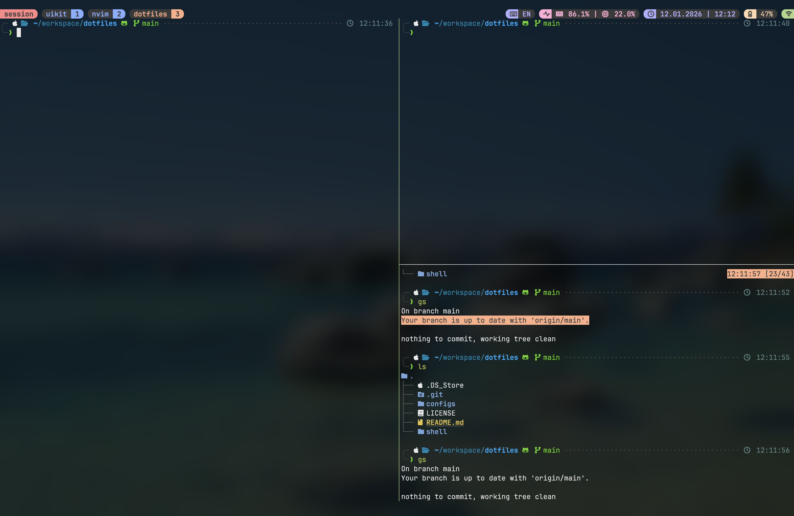
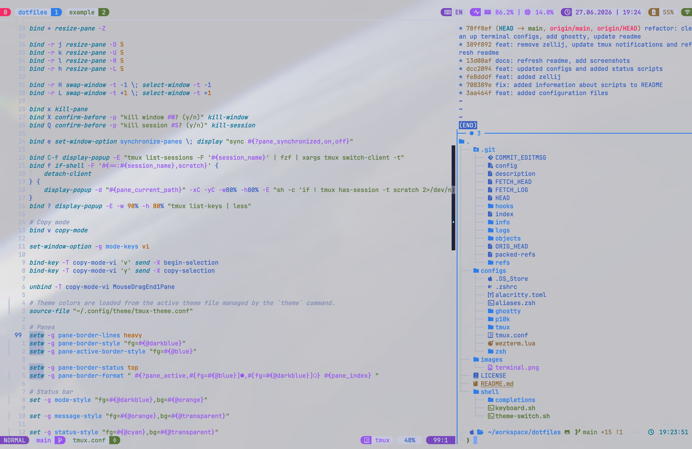

# Dotfiles

This repository contains configuration files for setting up a development environment across macOS, Linux, and WSL.

For the matching Neovim configuration, see [nvim-config](https://github.com/Pepetka/nvim-config).

## Configuration Files

### Terminal & Shell

- **`zsh/.zshrc`** — Main Zsh configuration with Oh My Zsh, Powerlevel10k, plugins, and environment settings
- **`zsh/aliases.zsh`** — Custom aliases and the `theme` command
- **`zsh/functions.zsh`** — Git, Yazi and Tmux helpers
- **`zsh/secrets.zsh.example`** — Example file for private API keys and secrets
- **`zsh/local.zsh.example`** — Optional device-specific tool paths and settings
- **`alacritty/alacritty.toml`** — Alacritty terminal emulator configuration
- **`theme/resources/alacritty/`** — Alacritty dark/light palettes
- **`wezterm/wezterm.lua`** — WezTerm terminal emulator configuration
- **`ghostty/config`** — Ghostty terminal emulator configuration
- **`theme/resources/ghostty/`** — Ghostty theme selections

### Terminal Multiplexers

- **`tmux/tmux.conf`** — Tmux configuration with custom keybindings, powerline-style status bar, popups, scratchpad, and plugins
- **`theme/resources/tmux/`** — Tmux dark/light palettes using tmux user options (`@bg`, `@fg`, ...)

### Shell Prompt

- **`theme/resources/p10k/p10k.zsh`** — One Powerlevel10k configuration using the terminal ANSI palette

### Shell Scripts

- **`theme/theme`** — Theme engine command; `shell/theme-switch.sh` remains a compatibility wrapper
- **`theme/`** — Portable Go engine, macOS backend, application adapters and resources
- **`shell/keyboard.sh`** — macOS input source indicator used by the Tmux status bar (shows `RU`/`EN`/etc.)

### Editor

- **[nvim-config](https://github.com/Pepetka/nvim-config)** — Matching Neovim configuration with native LSP,
  fzf-lua, and TokyoNight theme switching

### AI CLI

- **[configs/codex/](configs/codex/README.md)** — Portable Codex preferences, work/deep/review profiles,
  and a three-way installer that preserves local state and manual theme selection

## Screenshots

### Terminal — TokyoNight Moon (dark)



### Terminal — TokyoNight Day (light)



## Shared Theme Engine

One engine selects TokyoNight Moon/Day for Ghostty, WezTerm, Alacritty, tmux and Neovim.
It supports persistent manual overrides and automatic macOS appearance tracking.
All theme sources, application adapters, palettes, tests and installation logic live in [theme/](theme/README.md).

```bash
theme install    # requires Go >= 1.27 and Apple Command Line Tools
theme authorize  # with Ghostty open: allow Theme Automation to reload its config
theme auto       # follow the system (default)
theme dark       # persistent manual dark mode
theme light      # persistent manual light mode
theme status     # service, preference, mode and per-application diagnostics
theme sync       # reapply without changing preference
theme uninstall  # retain preference, last palettes and ANSI prompt
```

Reload existing terminal configurations once after migration. Thereafter changes do not require input or focus changes.
Neovim retains its existing dark/light mode-file contract. Powerlevel10k uses the terminal ANSI palette.
The macOS backend is separate from the portable Go engine; additional backends use an executable `read/watch`
contract, while application integration uses adapter interfaces. The first installer supports macOS.
See [architecture, migration, extending and verification](theme/README.md) for details.

## Color Schemes

- **TokyoNight Moon** — primary dark color scheme for tmux, Ghostty, Alacritty, WezTerm, Neovim, and p10k
- **TokyoNight Day** — primary light color scheme for tmux, Ghostty, Alacritty, WezTerm, Neovim, and p10k

## Installation Paths

Files should be placed/symlinked in the following locations:

```text
~/.zshrc
~/.p10k.zsh
~/.config/alacritty/alacritty.toml
~/.config/ghostty/config
~/.config/hunk/config.toml
~/.config/theme/
~/.config/zsh/secrets.zsh
~/.wezterm.lua
~/.tmux.conf
~/.tmux/keyboard.sh
```

## Installation

1. Clone the repository:

   ```bash
   git clone https://github.com/Pepetka/dotfiles.git "$HOME/dotfiles"
   export DOTFILES="$HOME/dotfiles" # Use your actual checkout location.
   ```

2. Create necessary directories:

   ```bash
   config_root="${XDG_CONFIG_HOME:-$HOME/.config}"
   mkdir -p "$config_root/alacritty" "$config_root/ghostty" "$config_root/hunk"
   mkdir -p "$config_root/theme" "$config_root/zsh" "$HOME/.tmux"
   mkdir -p "${ZDOTDIR:-$HOME}"
   ```

3. Back up existing files, then create symbolic links for the applications you use:

   ```bash
   # Zsh configuration
   ln -s "$DOTFILES/configs/zsh/.zshrc" "${ZDOTDIR:-$HOME}/.zshrc"

   # Terminal emulators
   ln -s "$DOTFILES/configs/alacritty/alacritty.toml" "$config_root/alacritty/alacritty.toml"
   ln -s "$DOTFILES/configs/ghostty/config" "$config_root/ghostty/config"
   ln -s "$DOTFILES/configs/hunk/config.toml" "$config_root/hunk/config.toml"
   ln -s "$DOTFILES/configs/wezterm/wezterm.lua" "$HOME/.wezterm.lua"

   # Tmux
   ln -s "$DOTFILES/configs/tmux/tmux.conf" "$HOME/.tmux.conf"
   ln -s "$DOTFILES/shell/keyboard.sh" "$HOME/.tmux/keyboard.sh"
   ```

   Aliases are sourced directly from `$DOTFILES/configs/zsh/aliases.zsh` in `.zshrc`, so no separate symlink is needed.
   `.zshrc` derives `DOTFILES` from its symlink target; the checkout may live anywhere.
   An explicitly exported `DOTFILES` takes precedence. Keep `XDG_CONFIG_HOME` consistent
   between the shell, terminal applications and service installation when using a custom root.

4. Run `"$DOTFILES/theme/theme" install` on macOS to create theme state, link the ANSI p10k config and start the engine;
   then `"$DOTFILES/theme/theme" authorize` with Ghostty open.

   For Codex, run `sh "$DOTFILES/configs/codex/install.sh" --dry-run`, then `sh "$DOTFILES/configs/codex/install.sh"`.
   See [Codex configuration](configs/codex/README.md) for update behavior and profiles.

5. Install Tmux plugins:
   - Install [Tmux Plugin Manager (TPM)](https://github.com/tmux-plugins/tpm)
   - Open Tmux and press `prefix + I` to install plugins

## Migrating an existing checkout

Configuration sources now live in `configs/<application>/`. Recreate existing
application symlinks using the paths above (back up real files before replacing them).
The old flat paths and palette compatibility links in `configs/` have been removed.
Copy and configure `zsh/local.zsh.example` before reloading Zsh: tool initialization
previously embedded in `.zshrc` now belongs to the device-local file.

Palettes have one canonical source in `theme/resources/<application>/`.
The engine reads those resources directly and publishes the selected palette under
`${XDG_CONFIG_HOME:-$HOME/.config}/theme/`; terminal configs consume that generated
state to follow dark/light changes. These generated files are not duplicate source links.

On Ubuntu, the shell and application configs can be used independently of the theme
service. The current theme installer and automatic appearance integration remain macOS
only. To use the matching Alacritty colors without the engine, for a static
Linux setup, copy the desired palette from `theme/resources/alacritty/` to
`$config_root/theme/alacritty-theme.toml`.
Likewise copy a Ghostty or tmux palette to `theme/ghostty-theme.conf` or
`theme/tmux-theme.conf` under your config root. WezTerm falls back to Moon when no
bridge is installed. Linux theme-engine installation will be handled separately.

## Prerequisites

### Shell setup

- **Zsh** — Required for `.zshrc`; aliases and completion work without optional frameworks
- **[Oh My Zsh](https://ohmyz.sh/)** — Optional framework for plugins
- **[Powerlevel10k](https://github.com/romkatv/powerlevel10k)** — Optional Zsh theme
  - Zsh loads `theme/resources/p10k/p10k.zsh` directly when Powerlevel10k is available

The shared Zsh config initializes completion, optional Oh My Zsh plugins, aliases
and the ANSI prompt. It does not discover Homebrew, alter library paths or start SDKs.
`ls` uses eza only when it is installed; otherwise the system command stays available.
`EDITOR` defaults to `nvim` when installed, otherwise `vim`.
The default plugins are `z`, `sudo`, `zsh-autosuggestions` and `zsh-syntax-highlighting`;
the Oh My Zsh `git` plugin is omitted because `aliases.zsh` defines its own Git aliases.
Path entries are deduplicated.

Copy `configs/zsh/local.zsh.example` to
`${XDG_CONFIG_HOME:-$HOME/.config}/zsh/local.zsh` and uncomment the settings this
machine needs. It loads after the Powerlevel10k instant prompt and before framework
setup, and contains examples for Homebrew, user executable paths, NVM, Bun, SDKMAN,
editor and plugin preferences.
On Ubuntu, use native packages and user paths; Homebrew is optional. Ubuntu's
`/etc/zsh/zshrc` runs `compinit` before Oh My Zsh does it again; skip the first call:

```bash
echo 'skip_global_compinit=1' >> "${ZDOTDIR:-$HOME}/.zshenv"
```

Ubuntu 24.04 and older ship tmux below 3.5, which ignores `extended-keys-format`.
Alacritty's `SimpleFullscreen` startup mode is macOS-only; on Linux the window opens
windowed.
Keep API keys in `zsh/secrets.zsh` under the same config root, outside Git.
Codex authentication, trusted projects and device-specific MCP configuration
remain local and are preserved by its installer.

The theme service and keyboard-layout indicator currently use macOS APIs;
automatic Linux appearance tracking still needs a separate backend/service installer.
Check shell portability with `bash shell/tests/portability.sh`.

### Optional Terminal Emulators

- **[Alacritty](https://alacritty.org/)** — Fast, cross-platform terminal emulator
- **[WezTerm](https://wezfurlong.org/wezterm/)** — GPU-accelerated terminal emulator
- **[Ghostty](https://ghostty.org/)** — Fast, native, feature-rich terminal emulator

### Optional Terminal Multiplexers

- **[Tmux](https://github.com/tmux/tmux)** — Terminal multiplexer
- **[Tmux Plugin Manager](https://github.com/tmux-plugins/tpm)** — Plugin manager for Tmux

### Zsh Plugins (installed via Oh My Zsh)

The `.zshrc` includes several plugins that enhance the shell experience:

- `zsh-autosuggestions` — Command suggestions
- `zsh-syntax-highlighting` — Syntax highlighting
- `fzf` — Fuzzy finder integration
- `git` — Git aliases and functions
- `nvm` — Node Version Manager integration
- `npm`, `bun`, `docker`, `direnv`, `extract`, `sudo`, and more (see `.zshrc` for full list)

## Features

### Tmux

- **Prefix** changed to `Ctrl + a`
- **Vi-style copy mode** with system clipboard integration
- **Mouse support** for selection, resizing, and scrolling
- **Popups**:
  - `prefix + f` — floating scratchpad session
  - `prefix + Ctrl + f` — fzf session switcher
  - `prefix + ?` — keybindings cheatsheet
- **Synchronize panes** toggle with `prefix + e` and visual `SYNC` indicator
- **Window management**:
  - `prefix + Shift + h/l` — swap window left/right
  - `prefix + x/X/Q` — kill pane/window/session
- **Powerline-style status bar** with session, layout, CPU/RAM, battery, and time widgets
- **TokyoNight Moon** color scheme

### Aliases & Functions

The configuration includes numerous aliases for:

- Git operations (`gs`, `ga`, `gc`, `gcom`, etc.)
- Navigation (`ls` with `eza`, directory shortcuts)
- Development tools (npm, docker, etc.)
- AI coding agent providers (`deepseek`, `zai`, `minimax`, `kimic`)

### Custom Functions

- `theme` — Select auto/dark/light, install, inspect and reconcile shared theming
- `yy()` — Yazi file manager integration
- `gcom()` — Smart git checkout `master`/`main`
- `hurl_pretty()` — Pretty-printed HTTP responses
- `ts3()` — Tmux three-pane development layout

## License

This repository is distributed under the MIT License. See the [LICENSE](LICENSE) file for details.
